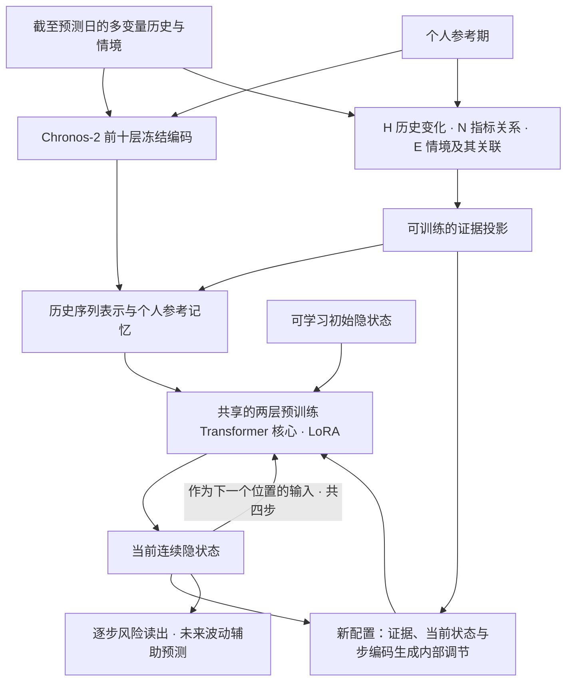

# HNE 第一篇 AI 论文的架构与核心

论文主线是把个人历史（H）、指标关系网络（N）和环境／行为情境（E）送入预训练时序模型，通过连续隐状态反馈，让模型在同一预测时点反复整合证据，输出未来多指标紊乱的风险。第一篇的模型级机制落在预训练 Transformer 核心的反复计算上。

与这条主线对应的已实现模型为 [HNELatent](../src/hne_latent.py)，配置为 [hne_latent.json](../configs/hne_latent.json)，训练入口为 [run_hne_latent.py](../scripts/run_hne_latent.py)。此前汇报的 AUROC 0.7796 / 0.6950 对应另一套 GRU 证据读取实现；本页下方给出两套实现各自的计算位置和成绩。本文架构整理依据 2026-11-19 的代码，实验数值来自已有训练产物。

给定一个人截至今天的多维记录，在最近一周仍处于其通常波动范围时，预测随后一周是否会出现跨指标的持续偏移或异常起伏。最有区分力的问题是：即使两种模型使用完全相同的历史、指标关系和环境，上一轮判断能否帮助模型在下一轮重新读取更有用的证据？

## 三个研究问题

| 问题 | 可检验的比较 | 读数 |
| --- | --- | --- |
| RQ1：哪些多指标节律证据有助于提前识别紊乱？ | 同一预测时点比较 HNE 和八种公开方法；在完整模型内逐项屏蔽 H、N、E | 公共样本 AUROC、AP；配对屏蔽前后 AUROC 差 |
| RQ2：基模内部的连续隐状态反馈能否改善预警？ | 四步 Transformer 反馈对同深度重置反馈、截断反馈梯度，并与单步计算比较 | 相同人员、样本和种子下的 AUROC 差、隐状态干预及计算成本 |
| RQ3：同一套预警规则能否迁移到另一领域的紊乱？ | 睡眠相关队列与代谢队列双向迁移，再分别迁移到大学生行为感知队列 | 冻结来源模型的目标域 AUROC，以及连续反馈相对单步和同深度重置反馈的增益 |

## 从输入到风险的计算链



**个人参考与统一证据。** 用个人前 56 天估计参考分布，在 8、16、32 天窗口中提取近期相对变化。H 编码偏移、振幅、尾部波动、趋势和自相关变化。N 编码指标之间的同步及滞后相关变化。E 编码活动、饮食等情境的变化、个人历史中情境与状态的关联，以及扣除该关联后的剩余波动。两库采用同一套特征计算和学习规则，按数据字段对应状态与情境。[证据实现](../src/hne_representation.py) · [统计量实现](../src/hne_features.py)

当前共同证据共有 296 个统计坐标，包括 H 的 96 维、N 的 36 维、E 的 128 维及情境调整后网络的 36 维；后两组进入 E 分支。N 由统计关系变化构造。情境调整使用个人参考期拟合的岭回归。样条变换、缩放和缺失填补参数在来源训练人员上拟合，三个投影网络把证据映射到 768 维。[变换实现](../src/hne_joint.py) · [分组尺度](../src/hne_refined.py)

**预训练表示与证据记忆。** 当前两个主库使用 32 天、每三小时一个点的六通道序列，其中五条状态通道、一条情境通道。冻结 Chronos-2 前十层，保留按时间和通道组织的表示。每个通道在历史表示之后接入五个额外向量，分别承载个人参考、通道统计、H、N、E。个人参考来自已观察到的参考期；迁移时目标人员也提供自己的参考期。[输入构造](../scripts/prepare_hne_routed.py) · [前十层编码](../scripts/prepare_hne_latent.py) · [memory 方法](../src/hne_latent.py)

**基模内部连续反馈。** 保留 Chronos-2 最后两个预训练 Transformer 块，四个内部步骤共享这两层的参数。每一步的最后隐状态乘以可学习反馈系数，作为下一个连续位置的输入，再经过同一组 Transformer 块。时间注意力读取历史位置和之前的隐状态，通道间注意力整合不同指标。历史记忆可以被多个步骤重复读取，四步计算均对应同一个真实预测日。实现保留跨步骤梯度及 KV 缓存的计算图。

用 M 表示历史、参考和 H/N/E 组成的记忆，z₀ 表示初始状态，g 表示可学习反馈系数，可写为

\[
z_k=\operatorname{Last}\!\left(T_{\theta,\Delta\theta}[M,z_0,gz_1,\ldots,gz_{k-1}]\right),\qquad k=1,\ldots,4.
\]

这里省略了通道下标。上一轮隐状态改变下一轮的查询及注意力分布，因此相同模型权重在不同个人输入上形成不同的连续计算轨迹。四个步骤的语义由训练产生，代码采用固定四步推理预算。Coconut 的隐状态回填机制是这一设计的参考。[本地已核对的 Coconut 源码记录](../literature/continuous_reasoning_methods.md) · [Coconut 作者实现](https://github.com/facebookresearch/coconut/blob/HEAD/coconut.py)

**风险读出。** 每步将状态通道的隐表示投影后做均值和最大值汇聚，读出未来事件概率。最终输出使用第四步。另一个预测头从第四步各通道表示预测未来窗口的均值和对数标准差，为隐状态提供连续的变化目标。

## 训练改变什么

冻结前十层及循环核心的原始预训练权重。在最后两层的时间注意力、通道间注意力中，对 Q、V 投影训练 rank-8 LoRA，同时训练 H/N/E 投影、参考相关的类型嵌入、通道统计投影、初始隐状态、反馈系数和输出头。LoRA 学习率为 0.00003，其余学习参数为 0.0003。

训练损失由第四步事件分类、前三步的平均事件分类和未来变化预测组成

\[
\mathcal L=\frac{\mathcal L_{\mathrm{event},4}+0.1\,\overline{\mathcal L}_{\mathrm{event},1:3}}{1.1}
+0.02\,\mathcal L_{\mathrm{future}}.
\]

事件项采用类别加权 BCE，未来项采用对标准化均值及对数标准差的 Smooth L1；每个训练批次均衡抽取参与者。最终损失沿四步计算反向传播到早期隐状态、证据投影和 LoRA，学习证据的使用方式。未来窗口只参与训练目标和结果评分，推理输入截止于预测日。以上目标已在 HNELatent 中实现。[损失与训练](../scripts/run_hne_latent.py)

五折按人划分，每次三折训练、一折验证、一折评估。训练人员内部再以三折选择轮数，按所选轮数重训三个种子。配置最多 32 轮，选轮过程至少运行 8 轮，以内部验证 AUROC 和对数损失选出较早或较晚的最佳轮数。训练轮数与每次预测的四个内部步骤是两个独立设置。

## 论文应围绕的三个核心点

1. **以个人参考组织 H/N/E 证据。** 把不同量纲、不同指标数的记录转成具有共同含义的变化证据，回答哪些联合变化提示未来紊乱。对应 RQ1。
2. **在预训练核心内反馈连续隐状态。** 模型利用前一步状态改变后一步计算，通过共享 Transformer 层、LoRA 和跨步监督学习证据整合。这是第一篇的主要模型级研究点，对应 RQ2。
3. **用同一证据定义和模型检验跨领域预警。** 冻结来源模型与来源训练人员拟合的变换，在目标域应用相同公式；目标人员的历史用于建立其参考状态。对应 RQ3。

这些是论文的方法主张。个人参考、相关统计、LoRA、连续隐状态反馈各有已有研究基础，新增贡献需要由它们在多变量未来紊乱任务中的具体结合与对应实验确立。[方法研究脉络](../literature/continuous_reasoning_methods.md)

## 2025—2026 文献驱动的模型级优化

本轮按会议出处、引用记录及作者代码筛选了 15 篇内部推理论文，重点采用 Coconut 的连续反馈、Huginn 的共享核心、SIM-CoT 的中间状态监督和 LoopFormer／TMLT 的内部调节思路。[阅读及源码入口](../literature/continuous_reasoning_methods.md) · [新配置](../configs/hne_latent_grounded.json)

**调节发生在 Transformer 内部。** 令 \(e=\operatorname{Mean}(P_H,P_N,P_E)\)，每个通道在第 \(k\) 步构造条件

\[
c_k=u_k+e+\operatorname{MLP}_{t}((k-1)/K,1/K),
\]

其中 \(u_1=z_0\)，后续 \(u_k=gz_{k-1}\)。每个共享块从自己的 LayerNorm 和 MLP 产生四组有界调节量：

\[
(s_k,a_k,n_k,f_k)=0.25\tanh\{\operatorname{MLP}_{b}(\operatorname{LN}_{b}(c_k))\}.
\]

时间注意力的归一化输入乘 \(1+s_k\)，时间注意力、通道注意力、前馈层的残差更新分别乘 \(1+a_k\)、\(1+n_k\)、\(1+f_k\)。这些量是逐通道、逐隐藏维度的向量。历史记忆位置不调节，只调节连续隐位置；共享核心及其缓存保留跨步梯度。调节头最后线性层零初始化，从预训练核心的原始计算出发学习更新方式。已有 LoRA、H/N/E 投影和输出头继续训练。

这样，训练同时改变参数和输入相关的更新过程。同一个人在不同情境、不同人面对相似波动时，可以形成不同的隐状态轨迹。四个步骤共同读取 H/N/E；没有预设某一步只处理一类证据。

**未来动态监督到每一步。** 各步用共享预测头解码个人参考标准化后的未来均值及 \(\log(1+\mathrm{std})\)，再按来源训练人员估计的均值和尺度归一化。新辅助项为

\[
\mathcal L_{\mathrm{future}}
=\frac1K\sum_{k=1}^{K}
 \operatorname{SmoothL1}(D(z_k),q_{\mathrm{future}}).
\]

事件损失及其 0.1 中间权重保持原样，未来辅助权重保持 0.02。各步预测同一个未来窗口，目标不规定推理顺序；逐步误差与状态干预检验计算是否改善。未来值只用于训练目标，预测输入截止于预测日。

**对应 RQ 的比较分离。** RQ1 比较公开算法及 H/N/E 证据消融；RQ2 比较下表的内部计算条件；RQ3 冻结来源模型，检验同一更新规则的跨领域作用。RESILIENT 与 BrisT1D-Open 共用配置，字段映射、目标和人员划分不变。

| 代码条件 | 内部调节 | 未来摘要监督 | 跨步状态与潜在 KV |
| --- | --- | --- | --- |
| recurrent | 开启，四步 | 所有步骤平均 | 保留 |
| no_modulation | 关闭，四步 | 所有步骤平均 | 保留 |
| clock_only_modulation | 开启，仅初始状态与步条件，四步 | 所有步骤平均 | 保留；调节量不依赖个人证据或更新状态 |
| final_future_only | 开启，四步 | 仅最后一步 | 保留 |
| reset_feedback | 开启，四步 | 所有步骤平均 | 显式反馈重置；禁止读取之前潜在位置 |
| single_pass | 开启，一步 | 唯一步骤 | 不发生跨步反馈 |

新配置的重置对照同时移除两条状态传递通路；原配置继续复现原实验。当前固定 \(K=4\)，尚未加入 LoopFormer 的长短轨迹一致性或 MoR 的自适应深度。固定预算的机制实验后，再以对应训练比较 1／2／4／8 步的性能、延迟和显存。

本轮开发实验使用外层 fold 0 对应的训练人员，在其内部做三折选轮，比较完整、无调节、仅终步监督及仅步条件调节；[输出目录](../results/hne_latent_grounded)。下列命令不执行外层验证／评估及三种子重训：

~~~shell
python scripts/run_hne_latent.py --config configs/hne_latent_grounded.json --output results/hne_latent_grounded --variants recurrent no_modulation final_future_only clock_only_modulation --folds 0 --selection-only
~~~

### 本轮内部开发结果

完成两库、四个条件、每个条件三个内部人员折，共 24 次拟合。使用外层 fold 0 的原训练人员：RESILIENT 36 人，BrisT1D-Open 12 人；内部选轮分数如下。它们用于方法选择，不替换下节五折评估结果。

| 内部计算条件 | RESILIENT AUROC | BrisT1D-Open AUROC | 所选轮数（RES／Bris） |
| --- | ---: | ---: | ---: |
| 证据、状态调节＋逐步未来监督 | 0.8263 | 0.6989 | 1／4 |
| 无调节＋逐步未来监督 | 0.8225 | 0.7018 | 1／4 |
| 同参数、仅步条件调节 | 0.8176 | 0.6979 | 3／8 |
| 证据、状态调节＋终步未来监督 | 0.8268 | 0.6926 | 1／4 |

完整条件相对同参数仅步条件高 0.0087／0.0010；相对无调节为 +0.0037／−0.0030。逐步未来监督相对终步监督为 −0.0006／+0.0063。两项修改各自的收益随队列变化。完整条件训练目标持续下降，但内部验证 BCE 在 RESILIENT 从 0.4013 升至 0.6511，在 BrisT1D-Open 从 0.4146 升至 1.1731，继续增加训练轮数不对应更好的验证表现。

据此，当前新配置保留为机制研究条件，原主实验成绩保持原实现对应关系。下一轮优先检验状态更新是否改善可观测的未来动态预测，并控制调节网络的容量；相同未来摘要在每步重复监督，尚未建立两库一致的增益。

[开发汇总 JSON](../results/hne_latent_grounded/summary/development_summary.json) · [四条件数值表](../results/hne_latent_grounded/summary/development_metrics.csv) · [各内部折的损失曲线数据](../results/hne_latent_grounded/summary/development_curves.csv) · [汇总脚本](../scripts/summarize_hne_latent_development.py)

## 已实现模型与结果的对应关系

| 实现 | 循环计算发生的位置 | RESILIENT AUROC | BrisT1D-Open AUROC | 结果来源 |
| --- | --- | --- | --- | --- |
| Transformer 内部连续反馈，论文主架构 | 两个共享的预训练 Transformer 块，隐状态写入下一连续位置，训练 LoRA | 0.7697 | 0.6475 | [hne_latent 汇总](../results/hne_latent/summary/metrics.csv) 中 recurrent 行 |
| GRU 证据读取，现有两表对应实现 | 冻结编码表示之后的 48 维 GRU，对三个汇聚证据向量执行四步读取，并修正基础风险 | 0.7796 | 0.6950 | [evidence_recursion 主表](../results/evidence_recursion/table1.csv) |

Transformer 实现相对单步的 AUROC 差为 −0.0190 / +0.0703；相对同深度重置反馈为 −0.0154 / +0.0876。两库对单步、重置反馈及截断梯度的同时置信区间均跨零。模型级机制的证据应从这组对照继续完善。当前一页两表保留其原实现的成绩。[反馈对照的统计区间](../results/hne_latent/summary/rq2_simultaneous_intervals.csv)

## 已完成的 GRU 证据读取实验

**预测时间。** 每人起始 56 天用于确定个人通常波动。预测日为 d，输入为截至 d 的 32 天，要求截至 d 的七天按协议可判定为正常。留出 d+1，用 d+2 至 d+8 的七天定义结局。每个指标族按个人参考期判断波动幅度放大或同方向持续偏移。至少两个合格指标族异常为阳性，观测不足以判定时排除该时点。一个自然人只进一个折。完整幅度、持续天数、观测覆盖条件见[标签协议](../configs/daily_protocol.json)。

**证据。** H 表示近期相对个人参考的水平、变化和持续性；N 表示多个指标之间关系的变化；E 表示情境和情境与指标关系的变化。RESILIENT 的步数和 BrisT1D-Open 的碳水摄入分别提供活动和饮食情境。预训练 Chronos-2 前十个编码块读取历史与参考序列，以有效位置的隐表示计算两者之差。历史分量接入 H，情境分量接入 E。H、N、E 的数值坐标用来源训练人员拟合的同一套变换转成三个记忆向量。两个队列共用同一模型、公式、目标和停止规则。

**模型内部的计算。** 初始状态为可学向量。每步用上一状态和步位置计算查询，与三个记忆向量的键做内积并归一化。所得权重决定本步读取的证据，证据经过同一个 GRU 单元更新 48 维状态。第四步读出未来风险。训练时梯度从最后一步穿过前三次更新。四次更新发生在同一个预测时点，均只读取当时已知的记录。Coconut 提供了把上一步隐状态作为下一步输入的思路；本研究增加了对三个时序证据向量的重复查询。[Coconut 原文](https://arxiv.org/abs/2412.06769) · [作者实现](https://github.com/facebookresearch/coconut/blob/HEAD/coconut.py) · [本研究实现](../src/hne_evidence_recursion.py)

直接递归模型从第四步隐状态预测全部风险。第二种实现先在来源训练人员上拟合带 L2 正则的加性风险分数 b，固定其系数；递归模型预测修正量，最终概率为 sigmoid(b + 0.5 × tanh(读出值))。修正量从零初始化。固定查询对照保留四步、共享单元、步位置和状态更新，只解除查询对上一状态的依赖。逐步重置对照每步回到初始状态，一步对照只执行一次更新。屏蔽某一证据时，同时关闭它的读取位置和对应加性项；这测量显式通路对预测的贡献，原始相关传感器仍可能在其他通路中携带信息。

## GRU 实验的训练与结果

**训练。** 每个队列五折按人划分，折 k 评估、下一折验证、其余三折训练。数值变换和基础风险系数均只在训练折拟合。三个随机种子为 20261114、20261115、20261116。AdamW，批量 256，最多 24 轮，连续 6 轮验证未改善即停止。以验证 AUROC 选轮，同分时取验证对数损失较低者。每人按其训练时点数的倒数加权；最终 BCE 加前三步平均 BCE 的 0.1 倍，再按总权重归一化。每一步都使用同一未来事件标签。带基础风险的模型允许选择第零轮。

**读数。** 来源域先在每个评估折平均三个种子的风险。PDF 两张表均使用所有主对照共有的评估时点，AUROC 以折内正负样本对数加权，AP 以折内时点数加权。表 2 报告各消融的绝对分数。下文 RQ1 和 RQ2 的配对差和区间使用机制对照共有的全部时点（1,990 / 1,238），按参与者配对重采样 2,000 次。双向迁移对目标折 k 使用来源折 k 的模型。对外部 College Experience，分别平均每个来源的五折、三个种子，共 15 个模型的风险。目标结局只用于评分。两个主队列为此前已经研究过的开发队列；增加基础风险的第二组实验由首轮曲线和结果提出。

- **RQ1。** HNE（Ours）由历史、指标关系和环境估计基础风险，再用四步连续隐状态修正预警分数。共同样本上，HNE 的 AUROC 为 0.780 / 0.695，外部对照中 AUROC 最高的 CATCH 为 0.765 / 0.651（顺序均为 RESILIENT / BrisT1D-Open）。两库分别含 55 人、1,938 个共同预测时点与 19 人、1,196 个共同预测时点。单独屏蔽 H、N、E 的配对区间均包含零。内部开发中，早期独立拟合的加性版本达到 0.801 / 0.708；本模型关闭隐状态修正后保留自身的基础风险，达到 0.783 / 0.696。
- **RQ2。** 完整四步比四步固定查询高 0.0044 / 0.0049，95% 区间分别为 [+0.0001, +0.0135] 与 [−0.0011, +0.0233]。四步相对一步的增益为 0.0033 / 0.0055，两库区间均跨零。完整模型相对它自己的冻结基础风险为 −0.0043 / −0.0005。直接递归原本只有 0.641 / 0.449。加入基础风险后，两库各 15 次完整模型训练中分别有 9 次和 8 次由验证集选中第零轮。现有结果把主要增益归于基础风险，未建立连续推理在两库的稳定优势。
- **RQ3。** BrisT1D-Open → RESILIENT 为 0.785，反方向为 0.692。在 College Experience 的 41 人、15,137 个时点（4,074 个阳性）上，两来源模型分别为 0.634 / 0.638，对应个体重采样区间为 [0.594, 0.670] / [0.595, 0.676]。冻结模型在外域保留风险排序能力；College 上动态查询与固定查询几乎持平。

两种模型族各跑 120 次，共 240 次。下一项能区分机制的实验是仅用来源训练数据分别监督隐状态预测未来的波动放大程度和持续偏移程度，再用相同辅助监督比较动态查询、固定查询及单步模型。独立队列在锁定这组对照后使用。单纯延长训练与已有选轮证据不符。

## GRU 实验复现与资料

从项目根目录运行以下命令，复用现有日级数据、按人分折、Chronos-2 前十层缓存及公开算法的逐时点预测。原始数据准备见 [Chronos 缓存入口](../scripts/prepare_hne_latent.py) 和[外部队列入口](../scripts/prepare_hne_external_refined.py)。运行配置见 [JSON](../configs/hne_evidence_recursion.json)。

```shell
python scripts/run_evidence_recursion.py
python scripts/run_evidence_recursion.py --anchored
python scripts/transfer_evidence_recursion.py
python scripts/transfer_evidence_recursion.py --anchored
python scripts/report_evidence_recursion.py
```

[一页两张结果表](../results/evidence_recursion/HNE_AI_1_tables.pdf) · [表 1 数值](../results/evidence_recursion/table1.csv) · [表 2 消融分数](../results/evidence_recursion/ablations.csv) · [完整配对差、区间与迁移](../results/evidence_recursion/table2.csv) · [15 篇论文与作者代码对读](../literature/continuous_reasoning_methods.md)

2026-11-16 的主表包含八项外部对照，其中近期实测方法为 Moirai 2.0、JAPE、Mantis 和 TimesFM 2.5。StepFM 在 RESILIENT 上评估睡眠等结局，GlucoFM-Bench 和 FedPhysio-Adapter 在 BrisT1D-Open 上预测血糖。表 1 统一使用未来第 2–8 天的多指标紊乱标签。[同队列文献、四项近期对照与复现入口](../literature/recent_public_warning_comparators.md)

公开队列来源：[RESILIENT](https://www.nature.com/articles/s41597-025-05958-x) · [BrisT1D-Open](https://data.bris.ac.uk/data/dataset/33z5jc8fa6tob21ptrugzqog08) · [College Experience](https://doi.org/10.1145/3643501)
